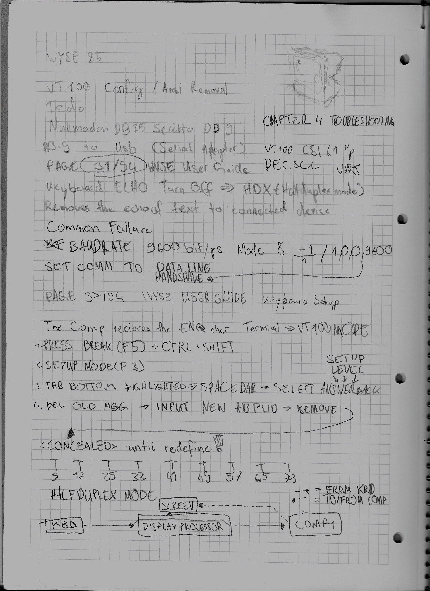

# WYSE WY-85 on Linux

Notes on getting a WYSE WY-85 serial terminal talking to a Linux machine. This covers the physical connection, VT100 mode, the slightly confusing duplex settings, and a login prompt using systemd, runit or dinit.

I started writing this while troubleshooting my own WY-85. Mine powers on, but I'm still sorting out keyboard input and the serial connection. Treat the setup below as a documented starting point, **not as a fully tested build**.

## Where to start

1. [Hardware and cables](docs/hardware-and-cables.md) — what you need, plus the connector trap
2. [WY-85 setup](docs/wyse85-setup.md) — F3, VT100, LOCL and saving settings
3. [Duplex modes](docs/duplex-modes.md) — LINE, ECHO / HDX and doubled characters
4. Pick your Linux init system:
   - [systemd](docs/linux-systemd.md)
   - [runit](docs/linux-runit.md)
   - [dinit](docs/linux-dinit.md)
5. [Troubleshooting](docs/troubleshooting.md) — no prompt, no keyboard input, LOCL, bad cabling

## Starting settings

These are the settings I'd start with, not a claim that every WY-85 should use them:

| Setting | Starting point |
| --- | --- |
| Emulation | VT100 |
| Baud | 9600 |
| Serial format | 8 data bits, no parity, 1 stop bit (8N1) |
| Local | OFF |
| Echo | OFF (full-duplex / LINE) |
| Linux terminal type | `vt100` |

The Linux side **must match** the terminal's serial settings. Other settings such as flow control also have to agree.

## My notes and photos

Some handwritten notes I took while configuring and troubleshooting the WYSE WY-85.

```markdown

```

## References

- [WY-85 User's Guide (1985), Bitsavers](https://bitsavers.trailing-edge.com/pdf/wyse/WY-85/88-060-01B_WY-85_Users_Guide_May85.pdf)
- [Linux `agetty` manual](https://man7.org/linux/man-pages/man8/agetty.8.html)
- [Void Linux handbook — runit](https://docs.voidlinux.org/config/services/index.html)
- [Dinit service description manual](https://davmac.org/projects/dinit/man-pages-html/dinit-service.5.html)

The original WYSE guide is linked, not re-hosted here.
